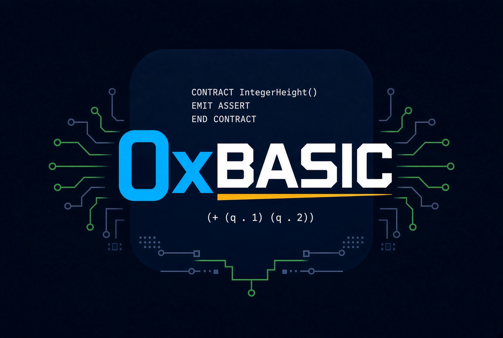

# 0xBASIC



**Structured BASIC for Chia smart contracts. Compiled directly to CLVM.**

0xBASIC brings the readable, beginner-friendly style of Microsoft QuickBASIC 4.5 to smart contract development on the Chia blockchain. It uses named functions, structured conditionals, explicit types, and `EMIT` statements—no line numbers. A Rust compiler translates familiar BASIC constructs into functional CLVM code.

The goal is to make contract development easier to learn without hiding how Chia's coin and condition model works.

**Early development · compiler `0.1.0-m3.8b` · Apache-2.0**

The compiler and local runner work today, but the language is incomplete and has not been audited for production use. The CLI runner checks CLVM behavior; it does not validate a blockchain spend. Do not use this development version to secure funds.

## A small working example

```basic
CONTRACT HeightLock(earliestHeight AS INTEGER)
    EMIT ASSERT_HEIGHT_ABSOLUTE(earliestHeight)
END CONTRACT
```

`earliestHeight` is fixed when the contract is bound into a puzzle. With `earliestHeight = 100`, this contract returns a condition requiring an absolute height of at least 100. Contracts execute using supplied data; they never prompt or wait for interactive input. `EMIT` adds a condition to the result; the blockchain enforces that condition when validating a spend.

## What works today

- Case-insensitive names, `AS` declarations, constants, local reassignment, assertions, and `IF` / `ELSEIF` / `ELSE`.
- Pure, nonrecursive functions and typed INTEGER, BOOLEAN, BYTES, STRING, AMOUNT, PUZZLEHASH, PUBLICKEY, PAIR, LIST, and CONDITION values inside programs.
- Byte operations, SHA256, integer encodings, strict UTF-8 conversion, and collection operations.
- INTEGER, BOOLEAN, BYTES, STRING, AMOUNT, PUZZLEHASH, PUBLICKEY, and nested PAIR/LIST fixed parameters and solution fields, with JSON conversion and generated CLVM boundary validation.
- `check`, `build`, `run`, and `explain --stage ast|ir|clvm` commands; reproducible artifacts, tree hashes, structured diagnostics, and execution-cost reporting.

`ASSERT_HEIGHT_ABSOLUTE`, `ASSERT_MY_AMOUNT`, `CREATE_COIN`, and `AGG_SIG_ME` are implemented as blockchain condition constructors. Isolated SpendSim and full-node harnesses verify signed payments and rejection/state checks on Windows and Linux. The specifications describe the intended language as well as features still being implemented; see the [status and roadmap](docs/development.md).

The optional [simulator harness](simulator/README.md) passes its environment smoke test on Windows and Linux. Compiled, signed payment testing also passes on both platforms. Height/signature rejection tests pass on both platforms. All 15 planned payment scenarios, including replay and payment-mutation checks, now pass on Windows and Linux. Reproducible simulator reporting and Windows/Linux CI also pass; M4 is complete. Compiler testing has passed on both platforms. The isolated full-node payment gate also passes on both platforms. [M5 experimental release quality](docs/spec/m5-release-plan.md) is in progress.

## Try it

You need Git, Rust installed through rustup, and a native C/C++ build toolchain. On Windows, use Visual Studio Build Tools with **Desktop development with C++**; on Linux, install your distribution's C compiler and build tools. The repository pins Rust **1.95.0**. Windows and Linux are tested; macOS has not yet been verified.

```text
git clone https://github.com/steppsr/0xBASIC.git
cd 0xBASIC
cargo build --workspace --locked
cargo run --locked -p oxbasic-cli -- check examples/height-lock.bas
cargo run --locked -p oxbasic-cli -- build examples/height-lock.bas --bindings examples/height-lock.bindings.json --out height-lock-build
cargo run --locked -p oxbasic-cli -- run height-lock-build/manifest.json --json
```

These commands work in PowerShell and Linux shells. The output directory `height-lock-build` must not already exist. A build produces binary CLVM, hex files, and a manifest recording the template and bound puzzle identities. The runner returns the raw condition tree corresponding to `((83 100))` and labels its result `clvm-execution-only`.

To inspect how the compiler sees a program without binding or running it:

```text
cargo run --locked -p oxbasic-cli -- explain examples/height-locked-payment.bas --stage ast --json
cargo run --locked -p oxbasic-cli -- explain examples/height-locked-payment.bas --stage ir --json
```

`ast` shows parsed syntax; `ir` shows the checked intermediate representation. Use `--stage clvm --template-only` to inspect generated CLVM, or `--stage clvm --bindings FILE` to include the bound puzzle. These debug views include source locations and may change with compiler versions.

Dependency downloads require internet access initially. Compilation and local execution then work with cached dependencies; no wallet or running Chia node is required. Python is only needed for the verification scripts.

## Explore and contribute

- [Examples](examples): small programs demonstrating implemented features. `height-locked-payment.bas` compiles and runs locally using its companion bindings file; separate simulator harnesses test signed, confirmed payments.
- [Implemented-feature reference](docs/spec/implemented-reference.md) and [payment tutorial](docs/spec/payment-tutorial.md).
- [Architecture](docs/architecture.md) and [language specification](docs/language-v0.1.md).
- [ABI](docs/spec/abi-v1.md), [CLI and artifact format](docs/spec/cli-v1.md), and [pinned target profile](docs/spec/target-profile.md).
- [Development status and roadmap](docs/development.md).
- [Contribution and testing guide](CONTRIBUTING.md).

Feedback, bug reports, and small focused contributions are welcome through [GitHub issues](https://github.com/steppsr/0xBASIC/issues) and pull requests. Language and artifact formats may change during development.

Visit [0xBASIC.com](https://0xbasic.com/) for the project introduction.

## License

[Apache License 2.0](LICENSE). 0xBASIC is an independent project and is not affiliated with or endorsed by Chia Network or Microsoft.
